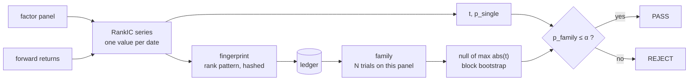

<p align="center">
  
</p>

<h1 align="center">alphaledger</h1>

<p align="center"><em>A trial ledger for factor research.</em></p>

<p align="center">
  
  
  
  
  
</p>

<p align="center"><sub>Every factor you evaluate is a draw from a lottery. alphaledger counts the draws —<br>and it will not judge one without knowing how many came before it.</sub></p>

---

## The problem, in one table

| | What you see | What you conclude |
|---|---|---|
| **One factor, on its own** | RankIC `0.0105`, t `3.03`, p `0.0027` | Significant. Ship it. |
| **The same factor, 200 draws deep** | the same numbers, plus `p_family = 0.346` | It is luck. Drop it. |

Nothing about the factor changed. Only the count did.

That count is the one thing an agent cannot keep. A researcher tests five ideas a day and remembers them. An agent tests two hundred an hour, and every session starts with a blank context.

---

## See it in twenty seconds

One command, on a panel of 300 names × 250 dates where **every factor is pure noise**:

```console
$ python demos/noise_200.py

  best factor     fp=v1:32625af66…
  RankIC          +0.0105
  t (iid / NW)    3.03 / 3.27
  p_single        0.00273   <- looks publishable
  family          200 trials
  bar_q95         3.67      <- what a real factor needed
  p_family        0.346     <- it is luck
  verdict         REJECT

  "Trial #200 of 200 — REJECT. IC=+0.0105, t=3.03, p_single=0.0027, p_family=0.346."
```

A RankIC of 1% is an ordinary magnitude for a **real** factor, so the size of the effect cannot tell you whether it is real. The only discriminating information is how many times you drew.

---

## How it works



Four tools sit on top of that loop:

| Tool | Question it answers | Cost |
|---|---|---|
| `fingerprint` | Have I tried this factor before? | free — no trial consumed |
| `evaluate` | What is its RankIC, and what is its trial number? | one trial |
| `gate` | Does it survive the family correction, and how far off was it? | free |
| `ledger_stats` | How much have I tried, and where am I going in circles? | free |

A `PASS` requires `p_family ≤ α`. `p_single` is reported and is never evidence.

---

## Install

alphaledger is an MCP server, wrapped in a four-file dsh plugin. One implementation,
two ways in; nothing leaves the machine and no API key is involved.

**DeepSeek Harness** — one command:

```console
$ dsh plugin --profile web add dsh-alphaledger
```

The bundle only writes the config that launches the server. If you would rather see it:

```yaml
- insert:
    - id: alphaledger
      name: '@deepseek-ai/dsh-mcp-client'
      config:
        serverName: alphaledger
        transport: stdio
        command: uvx
        args: ['alphaledger-mcp']
        failOnStartupError: true
```

**Claude Code, Codex, or any other MCP client:**

```bash
claude mcp add alphaledger -- uvx alphaledger-mcp
```

Tools appear as `mcp__alphaledger__evaluate`, `mcp__alphaledger__gate`, and so on.

<sub>Both routes need `uv` once (`curl -LsSf https://astral.sh/uv/install.sh | sh`),
because dsh deliberately does not manage Python environments. Neither package is on
PyPI or npm yet: until the release, use `dsh plugin add ./dsh/alphaledger` and
`uv pip install dist/alphaledger_mcp-0.1.0-py3-none-any.whl`.</sub>

> Dependencies are numpy and the standard library. scipy would double the install and add seconds to a cold start, and the two things we needed from it — rank correlation and Student-t tails — are a few dozen lines. See [`docs/METHOD.md`](docs/METHOD.md).

---

## Three things the ledger refuses to do

**It will not count `rank(x)` as a new factor.**
Identity is the factor's rank pattern, hashed as integers. `x`, `rank(x)`, `log(x)` and `2x+3` rank identically, so they are one trial with four evaluations. Flipping the sign is the same trial too — recorded as a `sign_flip`, which is the cheapest way a family quietly grows.

**It will not merge near-duplicates.**
Two factors correlating at 0.97 are reported as `NEAR_DUPLICATE` and left alone. Merging them would let *"I only changed one parameter"* escape the count, which is the entire problem.

**It will not pass a leaked factor.**
A factor ranked identically to the forward return is `LABEL_CONTAMINATION`, checked **before** significance — because that is the one case where the numbers look best.

---

## What it does not do

No data layer — you bring a panel, and an akshare adapter is planned. No backtest engine, no portfolio construction, no UI. It judges one factor's IC series and keeps the books, and that is all.

---

## Documentation

| | |
|---|---|
| [`docs/METHOD.md`](docs/METHOD.md) | Every formula, with the function and the test that pins it |
| [`docs/TOOLS.md`](docs/TOOLS.md) | Schemas, error codes, host wiring |
| [`docs/AUDIT.md`](docs/AUDIT.md) | Three existing dsh quant tools, read at source level |
| [`docs/CALIBRATION.md`](docs/CALIBRATION.md) | Measured false-positive rate and power |
| [`ROADMAP.md`](ROADMAP.md) | What shipped, what is v0.2 |

---

## Status

**0.1.0, unreleased.** Statistics, identity, ledger and the MCP surface are implemented and tested: 104 tests, `ruff` and `mypy` clean, false-positive rate 8.3% (1 in 12 studies), power 4 of 4 on a planted IC of 0.03.

v0.2: akshare adapter, one-shot OOS test lock, full look-ahead perturbation.

<p align="center"><sub>MIT © 2026 Zhenhao Fu</sub></p>
