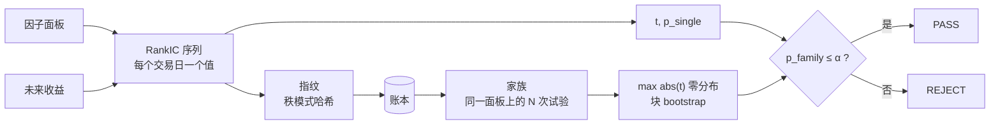

<p align="center">
  
</p>

<h1 align="center">alphaledger</h1>

<p align="center"><em>因子研究的试验账本</em></p>

<p align="center">
  
  
  
  
  
  
  
</p>

<p align="center"><sub>每评估一个因子，就是从彩票箱里抽一次。<br>alphaledger 记下抽了多少次，并且在不知道这个数字之前，拒绝下判断。</sub></p>

---

## 一张表说清楚问题

| | 你看到的 | 你会得出的结论 |
|---|---|---|
| **只看这一个因子** | RankIC `0.0105`，t `3.03`，p `0.0027` | 显著，可以用 |
| **同一个因子，放在第 200 次尝试里** | 完全相同的数字，加上 `p_family = 0.346` | 是运气，丢掉 |

因子本身没有任何变化，变的只有次数。

而这个次数，恰恰是 agent 记不住的东西。研究员一天试五个想法，还记得住；agent 一小时试两百个，每次会话都从空白上下文开始。

---

## 二十秒看懂

一条命令，300 只股票 × 250 个交易日，**每一个因子都是纯噪声**：

```console
$ python demos/noise_200.py

  best factor     fp=v1:32625af66…
  RankIC          +0.0105
  t (iid / NW)    3.03 / 3.27
  p_single        0.00273   <- 看起来可以发表
  family          200 trials
  bar_q95         3.67      <- 真因子需要的门槛
  p_family        0.346     <- 是运气
  verdict         REJECT

  "Trial #200 of 200 — REJECT. IC=+0.0105, t=3.03, p_single=0.0027, p_family=0.346."
```

RankIC 1% 对**真实**因子来说是很正常的量级——所以看效应大小分不出真假，唯一能分辨的信息是：你抽了多少次。

---

## 它怎么工作



这套循环之上只有四个工具：

| 工具 | 回答什么 | 代价 |
|---|---|---|
| `fingerprint` | 这个因子我试过吗？ | 免费——不消耗试验次数 |
| `evaluate` | IC 多少，这是第几次试验？ | 一次试验 |
| `gate` | 过了家族校正吗？差多远？ | 免费 |
| `ledger_stats` | 已经试了多少，哪里在打转？ | 免费 |

`PASS` 必须满足 `p_family ≤ α`。`p_single` 会报出来，但永远不算证据。

---

## 安装

alphaledger 是一个 MCP server，外面套一层四文件的 dsh 插件。一份实现，两条入口；不联网，不需要 API key，数据不出本机。

**DeepSeek Harness** —— 一条命令：

```console
$ dsh plugin --profile web add dsh-alphaledger
```

插件本身没有代码，只负责写下面这段启动配置；想看懂它做了什么，就是这几行：

```yaml
- insert:
    - id: alphaledger
      name: '@deepseek-ai/dsh-mcp-client'
      config:
        serverName: alphaledger
        transport: stdio
        command: uvx
        args: ['alphaledger-mcp']
        failOnStartupError: true
```

**Claude Code、Codex、或任何 MCP 客户端：**

```bash
claude mcp add alphaledger -- uvx alphaledger-mcp
```

装好后工具以 `mcp__alphaledger__evaluate`、`mcp__alphaledger__gate` 的形式出现。

<sub>两条路都需要先装一次 `uv`（`curl -LsSf https://astral.sh/uv/install.sh | sh`），因为 dsh 刻意不管 Python 环境。server 已发布到 PyPI；
npm 上的插件包还没发，所以 dsh 这条现在从源码目录装：`dsh plugin --profile web add ./dsh/alphaledger`。</sub>

> 依赖只有 numpy 和标准库。scipy 会让安装体积翻倍、冷启动多几秒，而我们需要的两件事——秩相关和 Student-t 尾概率——几十行就能写完。详见 [`docs/METHOD.md`](docs/METHOD.md)。

---

## 账本拒绝做的三件事

**不把 `rank(x)` 算成新因子。**
身份是因子的秩模式，用整数哈希。`x`、`rank(x)`、`log(x)`、`2x+3` 的秩完全相同，所以它们是**一次试验、四次评估**。翻符号也是同一试验，记为 `sign_flip`——这是家族悄悄膨胀最便宜的方式。

**不合并近似因子。**
相关性 0.97 的两个因子会被标成 `NEAR_DUPLICATE`，但不会合并。合并等于允许“我只改了一个参数”逃脱计数，而那正是要防的事。

**不让泄漏因子通过。**
与未来收益秩完全相同的因子会被判 `LABEL_CONTAMINATION`，**先于**显著性检查——因为那是唯一一种“数字看起来最好”的情形。

---

## 不做什么

不做数据层——你给面板，akshare 适配器在计划中。不做回测引擎、不做组合优化、不做 UI。它只判断一条 IC 序列，然后记账，仅此而已。

---

## 文档

| | |
|---|---|
| [`docs/METHOD.md`](docs/METHOD.md) | 每个公式，对应函数名与钉住它的测试 |
| [`docs/TOOLS.md`](docs/TOOLS.md) | 接口 schema、错误码、宿主接线 |
| [`docs/AUDIT.md`](docs/AUDIT.md) | 三份现有 dsh 量化工具的逐行审计 |
| [`docs/CALIBRATION.md`](docs/CALIBRATION.md) | 实测误报率与功效 |
| [`ROADMAP.md`](ROADMAP.md) | 已交付什么，v0.2 做什么 |

---

## 状态

**0.1.0。** 已发布到 PyPI（`alphaledger-mcp`）；npm 插件包尚未发布。统计内核、身份判定、账本、MCP 接口均已实现并通过测试：104 条测试，`ruff` 与 `mypy` 干净，误报率 8.3%（12 组中 1 次），对 IC=0.03 的植入因子功效 4/4。

v0.2：akshare 适配器、一次性 OOS 测试锁、完整前视扰动协议。

<p align="center"><sub>MIT © 2026 Zhenhao Fu</sub></p>
